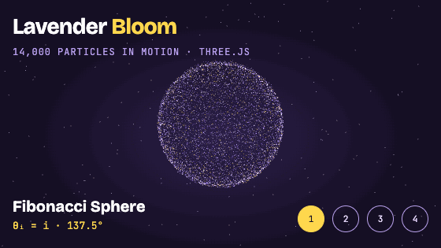

# Lavender Bloom

A three.js particle animation: 24,000 particles in lavender, white and yellow that bloom between a Fibonacci sphere, a rose curve, a trefoil torus knot and a spiral galaxy.

**Live demo:** https://harshini-bhandary21.github.io/lavender-bloom/

## Controls

- Click anywhere, press → / ←, or use the numbered buttons to change shape
- Move the mouse to tilt the bloom
- Shapes change on their own every 7 seconds (off when the system asks for reduced motion)

## How it works

Every shape is a precomputed array of particle positions. A custom shader morphs each particle from its old position to its new one with a per-particle delay and a swirl, then draws it as a soft additive glow.

Built with [three.js](https://threejs.org/) r128, no build step: open `index.html` in a browser.
